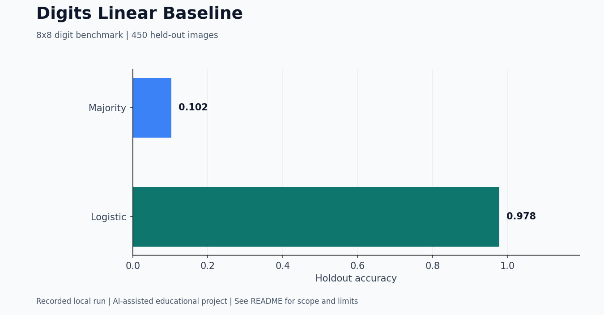

# Digits Linear Baseline

[](https://github.com/MoustafaMZaalouk/digits-linear-baseline/blob/main/.github/workflows/test.yml)

*Live workflow status, not a production-readiness or model-quality rating.*

Classify small grayscale digit images and inspect the most frequent confusion pairs.

A small educational project prepared with AI assistance for Moustafa Zaalouk's portfolio. This is new demonstration code, not a claim about past employment, research, clients or production deployment. It does not reuse another person's project under a different name.

## Run it

Use Python 3.10 or newer. The recorded local run used Python 3.10.12. A virtual environment is recommended.

```bash
python -m venv .venv
source .venv/bin/activate
pip install -r requirements.txt
python demo.py
python -m unittest -v
```

On Windows use `.venv\Scripts\activate` instead. The first command runs the full experiment and writes `results.json`. The second runs four checks. No API keys, paid services or internet data downloads are needed after dependency installation.

## Recorded results



These values are generated from `results.json`, not estimated or copied. Rerun the code to check them. Minor numerical differences may occur across platforms. Full per-example or per-fold details, where applicable, are in the JSON file.

| Measure | Local result |
| --- | ---: |
| Accuracy | 0.977778 |
| Macro F1 | 0.977641 |
| Majority accuracy | 0.102222 |
| Seed | 42 |
| Test rows | 450 |
| Train rows | 1347 |

`verification.txt` records the local test run. The included GitHub Actions workflow is a reproducible check, not a claim that remote CI has already passed.

## How to read the code

1. `demo.py`: data construction/loading, split, model, evaluation and output.
2. `test_demo.py`: output consistency and three experiment-specific checks.
3. `results.json`: the actual captured local results.
4. `requirements.txt`: exact versions used locally.

## Publishing and CI

The initial source is stored as a checksummed ZIP inside the workflow so GitHub can restore exact filenames and the chart without a manual multi-file upload. On its first run it unpacks this original AI-assisted source, tests it, runs the experiment and commits the initialized files as `github-actions[bot]`. Later runs test the actual checked-out source; they do not overwrite it from the bundle. This automation history is not a claim of manual authorship or review.

## Data and attribution

scikit-learn built-in Digits dataset, loaded through sklearn.datasets.load_digits. See the upstream dataset attribution and terms: https://scikit-learn.org/stable/modules/generated/sklearn.datasets.load_digits.html. Dataset bytes are not redistributed in this repository.

The experiment uses NumPy, SciPy and scikit-learn rather than claiming to implement their estimators from scratch. Their licenses and dataset terms remain separate from this repository's MIT license. No upstream code, author name or license was removed.

## What this does not prove

These are 8x8 centered benchmark images, not phone photos, handwriting OCR or Arabic digits. A random image split does not establish writer-independent generalization. No CNN or production accuracy claim.

## شرح بالمصري

الفكرة: نصنف صور أرقام صغيرة بموديل خطي. جدول confusion_matrix بيبين الغلطات. دي صور benchmark جاهزة، مش دليل إنه هيقرأ أي صورة من الموبايل.

لما تشرح المشروع: قول مصدر الداتا، اتقسمت إزاي، إيه الـbaseline، بنقيس بإيه، وإيه حدود النتيجة. ما تقولش إنه شغال في production أو نتيجة على داتا حقيقية لو التجربة صناعية.

## Next experiment

Replace the demonstration data with an appropriately licensed dataset, define an independent evaluation protocol before tuning, and report failures as well as successes. Keep private data and credentials out of commits.
